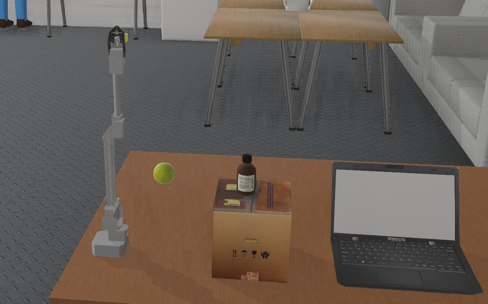
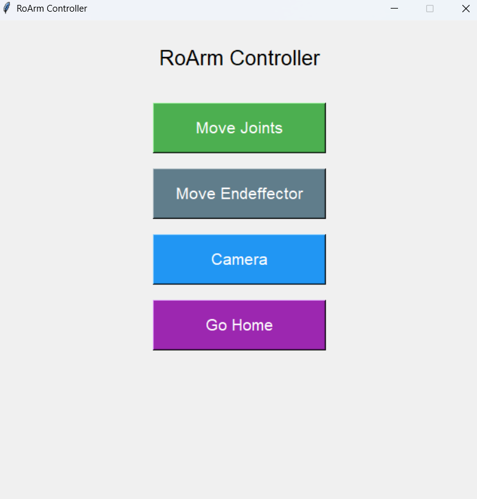
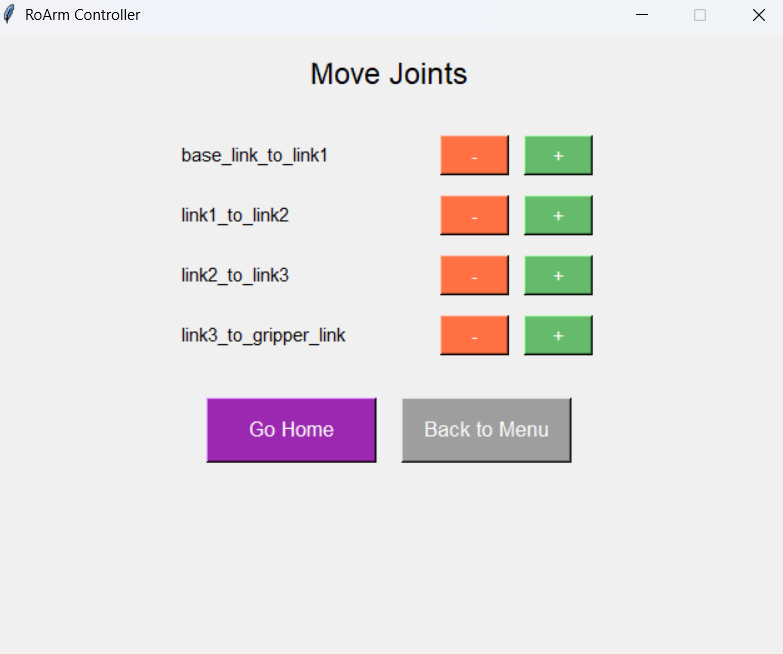
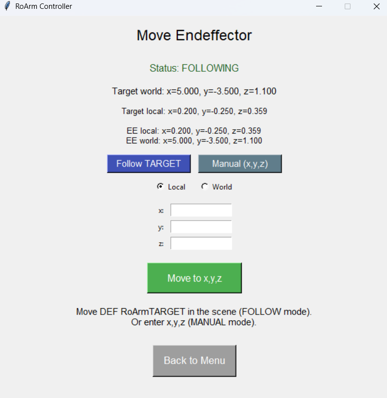
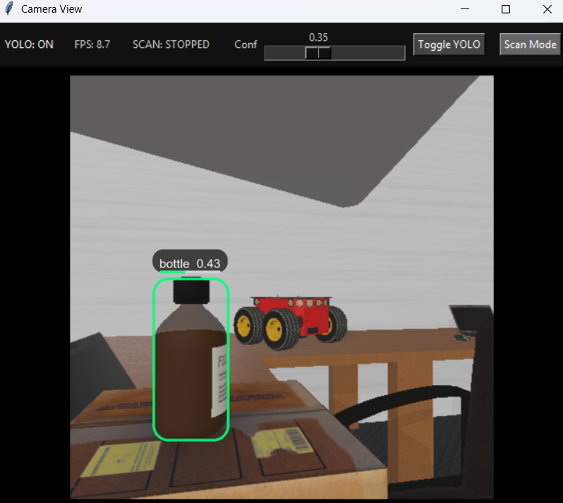

# RoArm-M3-Pro Simulation in Webots

A **Webots-based simulation** of the **Waveshare RoArm-M3-Pro**, a 5+1 DOF desktop robotic arm. This collaborative project explores robotic arm modeling, joint control, end-effector positioning, and motion trajectories using **Python**.



## Overview

This project provides a simulation environment for studying the behavior and control of the RoArm-M3-Pro manipulator without requiring physical hardware. It is designed for robotics education, kinematics experiments, controller development, and visualization of arm movements.

The model and controllers may also provide a starting point for future work in robotic manipulation, imitation learning, and ROS 2 integration.

## Features

- 5+1 DOF robotic arm model with joint constraints
- Joint-level control and interactive motion commands
- End-effector positioning and movement tracking
- Predefined trajectories, including circular, square, and rectangular paths
- Object-scanning demonstrations
- Python controllers and Webots simulation worlds
- URDF files for potential use with other robotics frameworks

## Robot Specifications

| Parameter | Specification |
| --- | --- |
| Model | Waveshare RoArm-M3-Pro |
| Degrees of freedom | 5+1 DOF (including 2-DOF wrist) |
| Payload | 200 g at 0.5 m |
| Reach / workspace | Approximately 1 m |
| Base rotation | 360° |
| Servos | ST3235 serial bus servos |
| Control board | ESP32-based (behavior simulated) |
| Arm weight | Approximately 1020 g |
| Mounting | Desktop / table-edge clamp |

*Specifications are based on the manufacturer's documentation.*

## Technologies

- **Webots** — robot modeling, simulation, and visualization
- **Python** — controller scripts
- **URDF** — robot description files
- **3D assets and textures** — robot appearance

## Repository Structure

```text
RoArm-M3-Pro-Simulation/
├── Media/             # Screenshots and simulation media
├── URDF Project2/     # URDF files
├── controllers/       # Python control scripts
├── protos/            # Webots PROTO definitions
├── textures/          # Visual assets
├── worlds/            # Webots world files
└── README.md
```

## Simulation Results

### Robot View


### Main Menu and Controls



### Joint Movement



### End-Effector Movement and Tracking



### Object Scanning



## Potential Extensions

The environment could be extended to explore inverse kinematics, advanced motion planning, vision-guided manipulation, imitation learning, and ROS 2 workflows. These are possible future directions, not claims that all such features are already implemented.

## Project Team

**Developed collaboratively by:**
- Negar Naghavian
- Mohammad Mahdi Khademi

**Academic supervisor:** Dr. Seyed Hassan Zabihifar
